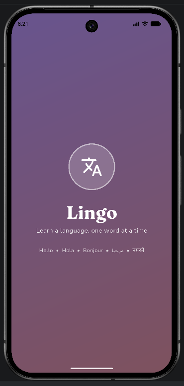
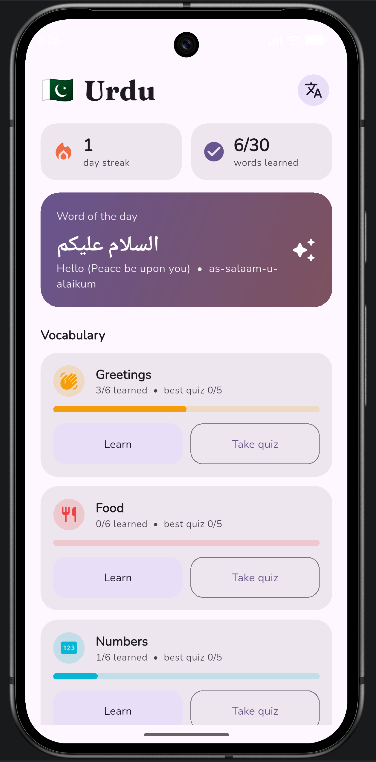
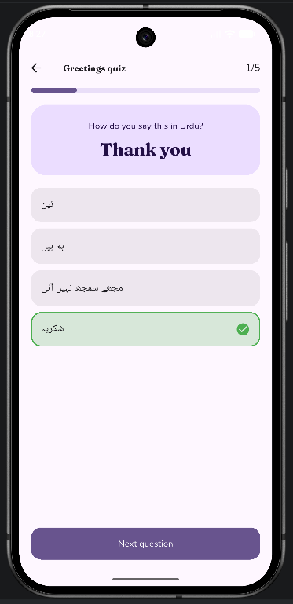
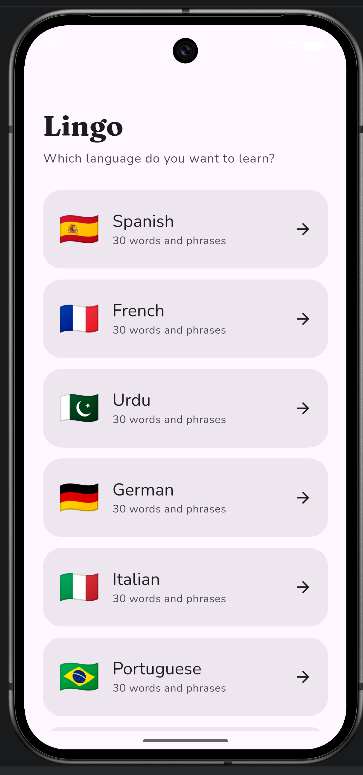
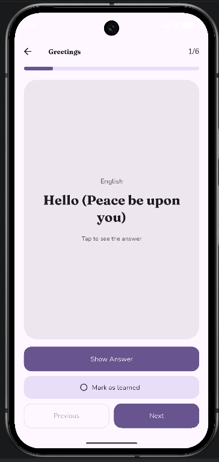

<div align="center">

# 🌍 Lingo

### A language learning app built with Flutter

Learn words, phrases and grammar with flashcards, pronunciation and quizzes.


*Task 3 of the CodeAlpha App Development Internship*

</div>

---

## 📖 About

Lingo helps users learn a new language step by step. Pick a language, study flashcards with translations and pronunciation guides, then test yourself with a quiz. Your progress, best scores and daily streak are saved on the device, so you can pick up where you left off.

## 📸 Screenshots

|                      Splash                      |                      Home                      |                      Quiz                      |
|:------------------------------------------------:|:----------------------------------------------:|:----------------------------------------------:|
| ** | ** | ** |

|                 Choose A Language                  |                      Flashcard                      |
|:--------------------------------------------------:|:---------------------------------------------------:|
| ** | ** |


## ✨ Features

**Learning**
- 9 languages: Spanish, French, German, Italian, Portuguese, Turkish, Urdu, Arabic and Hindi
- 5 topics per language: Greetings, Food, Numbers (Vocabulary), Phrases and Grammar
- Flashcards with an animated flip, a **Show Answer** button and **Previous / Next** navigation
- Pronunciation guide (romanised) on every card
- Mark words as learned

**Practice**
- 5-question multiple-choice quizzes for every topic
- Questions go both ways: English to the language, and the language to English
- Instant right or wrong feedback and a results screen with your score
- Option to retry the quiz or review the cards

**Progress and motivation**
- Progress bar for every topic and an overall words-learned counter
- Best quiz score per topic
- Daily streak
- Word of the day

**Design**
- Animated splash screen on launch
- Material 3 with a violet colour theme, in light and dark mode that follow the system setting
- Fraunces for headings and Nunito for body text
- Each topic has its own colour and icon
- Right-to-left text support for Urdu and Arabic

## 🛠 Tech stack

| Purpose | Package |
|---|---|
| Framework | Flutter and Dart |
| Local storage | [`shared_preferences`](https://pub.dev/packages/shared_preferences) |
| Fonts | [`google_fonts`](https://pub.dev/packages/google_fonts) |
| State management | `ChangeNotifier` with `ListenableBuilder` (no extra package) |

## 🗂 Project structure

```
lib/
├── main.dart                  App entry point
├── app.dart                   MaterialApp and root navigation
├── core/
│   ├── theme.dart             Light and dark themes
│   └── constants.dart         Topic groups, icons and colours
├── models/
│   └── language.dart          Lang model and word type
├── data/
│   └── language_data.dart     Words for every language and topic
├── state/
│   └── app_state.dart         Progress, streak and local saving
├── screens/
│   ├── splash_screen.dart     Animated launch screen
│   ├── language_screen.dart   Choose a language
│   ├── home_screen.dart       Dashboard, word of the day, topics
│   ├── lesson_screen.dart     Flashcards
│   └── quiz_screen.dart       Quiz and results
└── widgets/
    ├── flip_card.dart         Animated flip card
    ├── stat_card.dart         Streak and learned counters
    └── category_tile.dart     Topic card with Learn and Quiz buttons
test/
└── data_test.dart             Checks that the word data is complete
```

## 🚀 Getting started

### Requirements
- Flutter 3.22 or newer ([install guide](https://docs.flutter.dev/get-started/install))
- Android Studio with the Flutter and Dart plugins
- An Android emulator or a physical Android device

### Installation

```bash
# 1. Clone the repository
git clone https://github.com/noorfatima-0319/CodeAlpha_LanguageLearningApp.git
cd CodeAlpha_LanguageLearningApp

# 2. Generate the Android platform files (only needed if the android/ folder is missing)
flutter create --platforms=android --project-name lingo .

# 3. Install dependencies
flutter pub get
```

### Android configuration

Open `android/app/src/main/AndroidManifest.xml` and add this above `<application>` so the fonts can download on first launch:

```xml
<uses-permission android:name="android.permission.INTERNET"/>
```

### Run

```bash
flutter run          # run the app
```

## 🗺 Ideas for the future

- Firebase sign-in and cloud sync
- Audio pronunciation
- More languages and topics
- Daily lesson reminder notifications
- Spaced repetition for words you got wrong
- Speaking practice with speech recognition

## 🎓 Internship task

This project was built for **Task 4: Language Learning App** of the [CodeAlpha](https://www.codealpha.tech) App Development Internship.

| Requirement | How Lingo covers it |
|---|---|
| Learn words, phrases or sentences in a selected language | Language picker with words, phrases and grammar |
| Daily lessons or flashcards with translations and pronunciations | Flashcards, pronunciation guides, word of the day |
| Quizzes or practice tests | 5-question quiz per topic with scores |
| Clean UI with categories such as vocabulary and grammar | Material 3 design with a splash screen and Vocabulary, Phrases and Grammar groups |
| Learning data stored locally or synced | Saved locally with `shared_preferences` |

## 👤 Author

**Your Name**
- LinkedIn: [Noor Fatima](https://www.linkedin.com/in/noor-fatima-6034bb3b4/)
- GitHub: [noorfatima-0319](https://github.com/noorfatima-0319)

## 📄 License

This project was created for educational purposes as part of the CodeAlpha internship.
